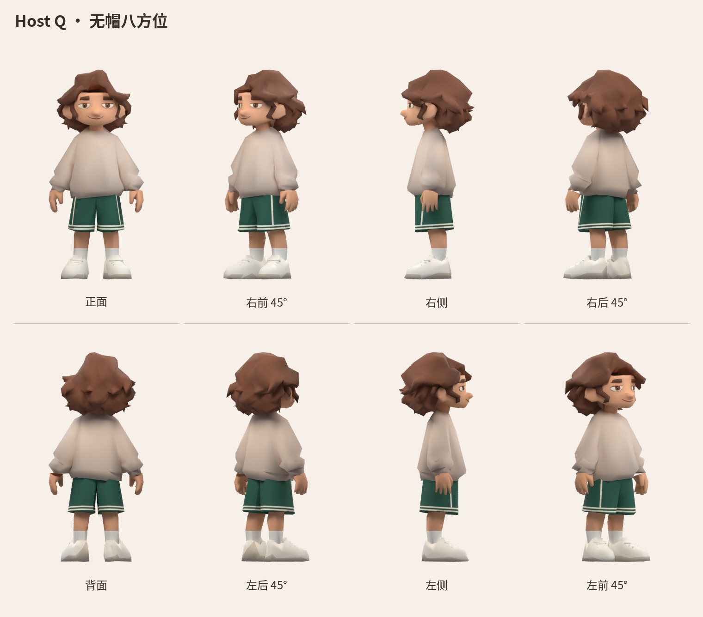
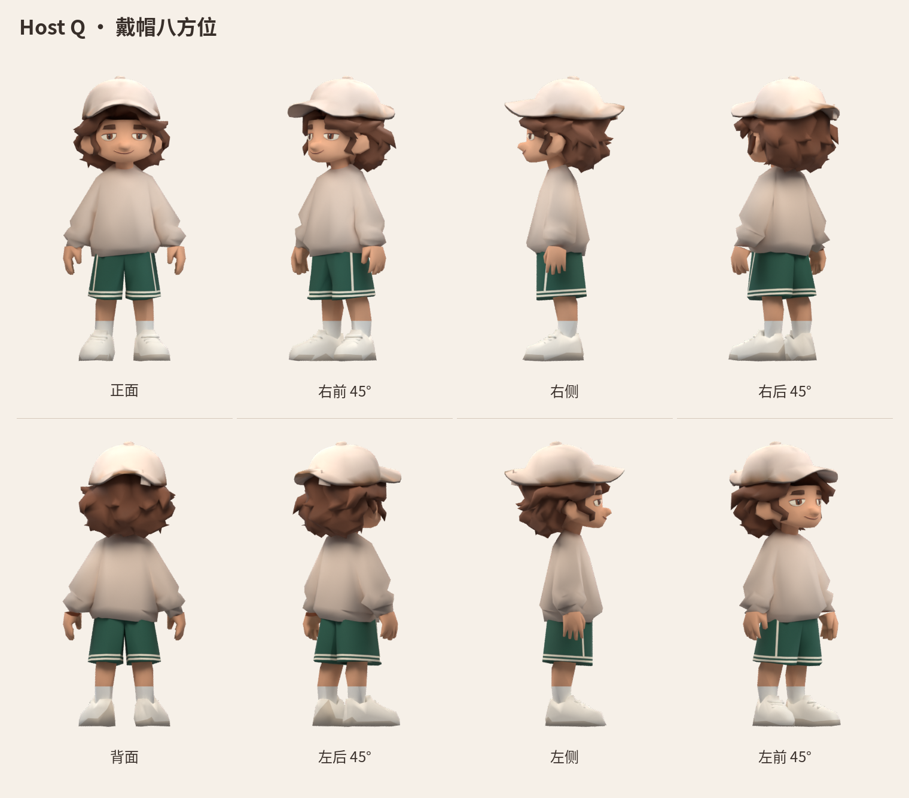
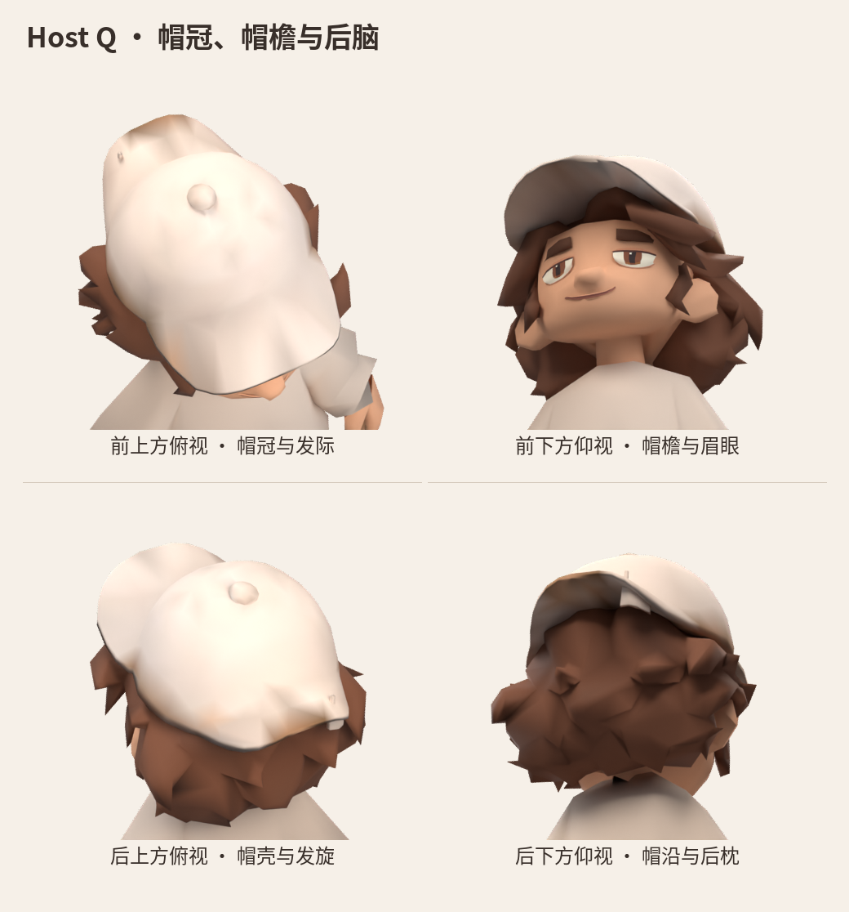

# Host Q 营主 / 司机 · r2s1 造型评审

请对照已确认的 rfc_06 无帽三视图，评估这版静态角色。先看无帽轮廓与五官，再看戴帽后哪些角度影响辨识。请在[角色造型讨论 #106](https://github.com/daniel-to-the-moon/camp-empire/issues/106)反馈，可注明图号、视角、部位和建议。例如「图 10，后下方，后枕与帽沿之间的空隙是否需要再收」。造型结论待成员确认。

## 全身八方位

两组视图分别从对应的游戏版 GLB 直接在 Blender 中渲染。以角色自身的左右为准，从正面起每次绕行 45°，相同机位、比例与灯光可以逐格对看。点击图片可放大。

## 俯视和仰视

请看前下方能否读出半睁眼和短眉，后下方帽沿与发块的间隙是否显眼。身体与帽子的贴合区仍有三角面相交，后枕下缘有细尖。

## 参考与局部

| 评审部位 | 图像 | 请确认 |
| --- | --- | --- |
| 角色轮廓 | [01 无帽与 rfc_06](previews/01_reference-barehead.png) · [02 戴帽与 rfc_06](previews/02_reference-capped.png) · [03 细雕前后](previews/03_r2-before-after.png) | 头发是否读得出大块波浪，耳侧和衣领间有没有粘在一起的感觉。游戏版头身比约 1:3.75，目标约 1:3.5。 |
| 五官 | [04 正脸与斜侧脸](previews/04_face.png) | 半睁眼、短眉和轻微微笑是否接近参考，眼睑厚度是否自然。 |
| 手、短裤、鞋袜 | [05 双手](previews/05_hands.png) · [06 鞋跟与鞋带](previews/06_shoes.png) · [08 全身](previews/08_barehead-eight-views.png) | 五指在斜侧是否能分辨，裤脚双白条和侧条是否连贯，鞋跟是否仍显厚重。 |
| 帽子贴合 | [07 帽沿与后枕](previews/07_cap-brim.png) · [10 俯仰特写](previews/10_cap-above-below.png) | 请指出穿插或透空最明显的角度，评估帽檐的宽度和弯度。 |

## 可旋转查看的样件

戴帽共 **2,991 个三角面**（身体 2,331，独立帽 660），上限 3,000。帽顶高 1.318737 m。角色采用单材质顶点色，当前用于静态造型评审。

- [戴帽 GLB](glb/host_q_tripo_p20_r2s1_capped.glb) · [无帽 GLB](glb/host_q_tripo_p20_r2s1_barehead.glb) · [独立帽 GLB](glb/host_q_tripo_p20_r2s1_cap.glb)
- [游戏面数版 Blender](blender/host_q_tripo_p20_r2s1_game.blend) · [细雕高模 Blender](blender/host_q_tripo_p20_r2s1_hi.blend)
- [面数、尺寸、节点变换、SHA256 与已知问题](NOTES.md)
