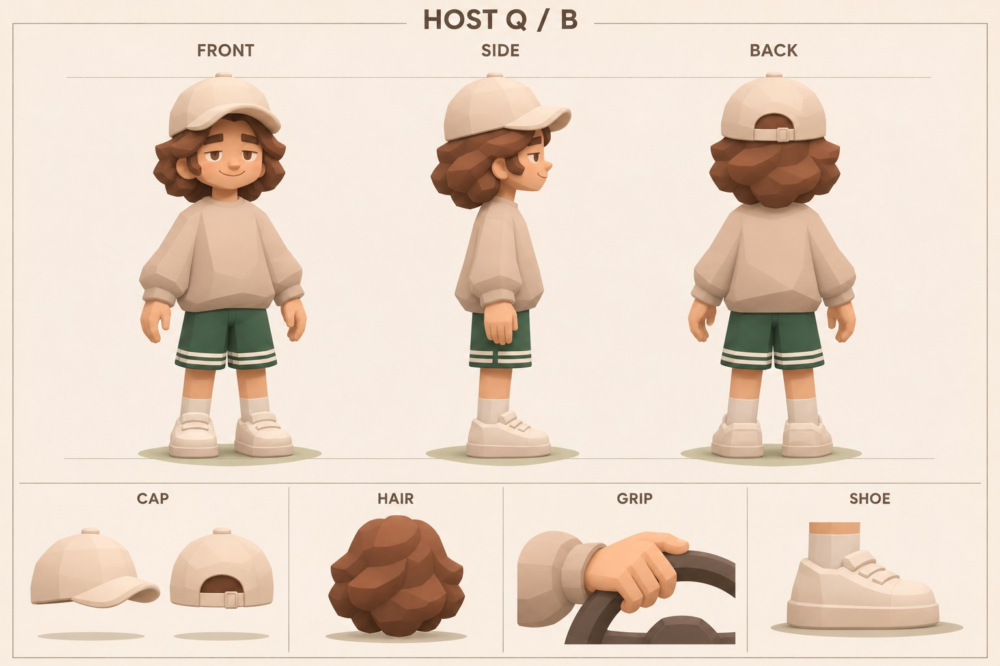

# Host Q · B 版造型与网页验收

依据：维护者选定 B「大面块＋局部倒角」。图是 ImageGen 人工参照，不是可上线模型、纹理或合规证明。

## 建模、骨骼与动作

- 以 r2s2 游戏低模为基础；先按 [#117 帽子反馈](https://github.com/daniel-to-the-moon/camp-empire/issues/117#issuecomment-7236975257) 修独立素帽：仅额前一片帽舌；背面只留贴头的开口和调节带。锁定无帽身体对照，不用头发填帽沿。约 1:3.5、3–5 块大发团、宽松米色长袖、绿短裤白边、白袜白鞋。
- 最终静态候选经确认后，按 [#94](https://github.com/daniel-to-the-moon/camp-empire/issues/94) **只给游戏低模做蒙皮与动作交付**；高模只作雕刻参照，不进网页。身体、独立帽预算合计 ≤3,000 三角；沿用单材质顶点色，衣褶、鞋带优先用顶点色，关节、握盘手型保留必要几何。帽子随头骨，不让帽沿参与摆动。
- 骨名和动作兼容按 #94；交 Blender 源、带蒙皮的 GLB、骨骼/动作/挂点清单。先验 Idle / Walk / Driving 三类，记录实际 clip 名称；驾驶座椅和方向盘联动按 [#88](https://github.com/daniel-to-the-moon/camp-empire/issues/88)，不改变车辆物理、操控或结算。

## 网页通过条件（待实测）

- 在候选 SHA 对应的预览中用游戏加载器实际加载 GLB。桌面 Chrome 与手机 Safari 各跑一次；至少记录冷加载、刷新、切视角，无缺资产/解码/着色错误，不黑屏，不载入高模。
- 实际操作走→停→再走、入座驾驶与下车；驾驶按中→左→中→右→中，转向盘和双手同向同步，不滑脱或明显穿模；刹停后姿态能恢复，走路脚不明显滑地。录一段跟随远景和一段驾驶近景；既有驾驶和营地交互不回退。
- 记录目标提交、预览环境、设备/浏览器、GLB 字节数、三角面、帧耗；按 #94 同屏 4 人复跑性能预算。61–71 px 是现有 Blender 跟随镜头模拟，不是网页实测。没有可操作预览或实测证据时不得标通过。

本补充只冻结 B 视觉方向与验收条件；当前未绑骨、未接入、未验证网页，不合并、不发布。
