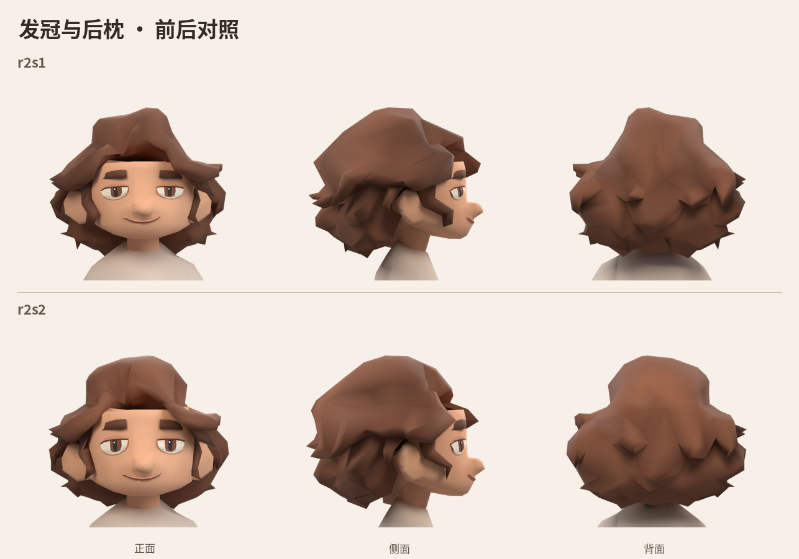
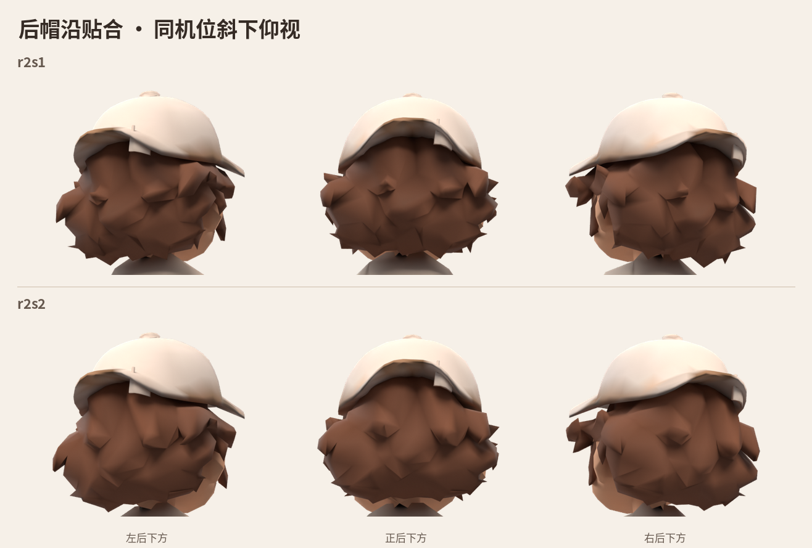
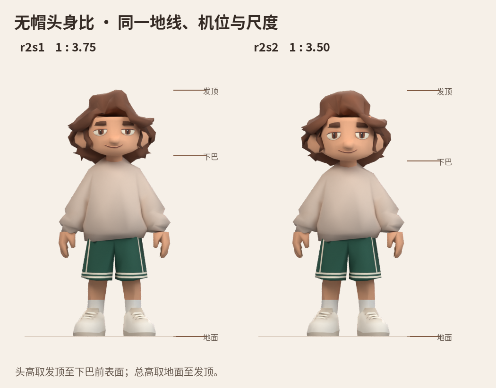

# Host Q 营主 / 司机 · r2s2 静态造型复审

本轮从已修正鞋底和鞋带的 r2s1 高模续雕。请先看图 02 的无帽发冠，再看图 03 的后帽沿，最后用图 05 判断头身比。游戏版头身比从 1:3.75 调整到 1:3.50，戴帽共 2,993 三角面。造型结论待盛俊或其授权评审确认。[任务及开工确认 #117](https://github.com/daniel-to-the-moon/camp-empire/issues/117)

## 发冠与帽沿

请观察两侧卷发能否读成大块波浪，后枕下缘是否还有抢眼的细尖。后帽沿下的垂直间隙已缩小；斜下方仍可见局部暗缝，身体与帽壳仍有三角面相交。

## 全身与比例

[图 01 · rfc_06 与无帽全身三视](previews/01_reference-barehead.png) · [图 04 · 戴帽全身三视修正前后](previews/04_capped.png) · [图 06 · 跟随镜头的实际像素大小模拟](previews/06_follow-distance.png)

## 模型文件

- [可编辑细雕高模](blender/host_q_tripo_p20_r2s2_hi.blend) · [游戏面数版 Blender](blender/host_q_tripo_p20_r2s2_game.blend)
- [无帽 GLB](glb/host_q_tripo_p20_r2s2_barehead.glb) · [独立帽 GLB](glb/host_q_tripo_p20_r2s2_cap.glb) · [戴帽 GLB](glb/host_q_tripo_p20_r2s2_capped.glb)
- [尺寸、三角面、复测方法、SHA256 和遗留问题](NOTES.md)
